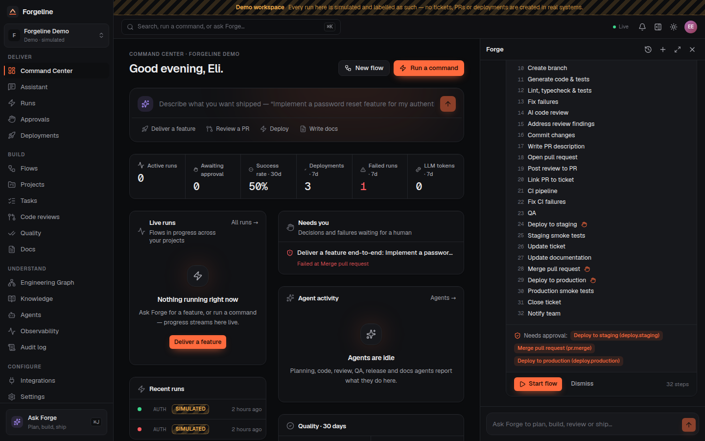
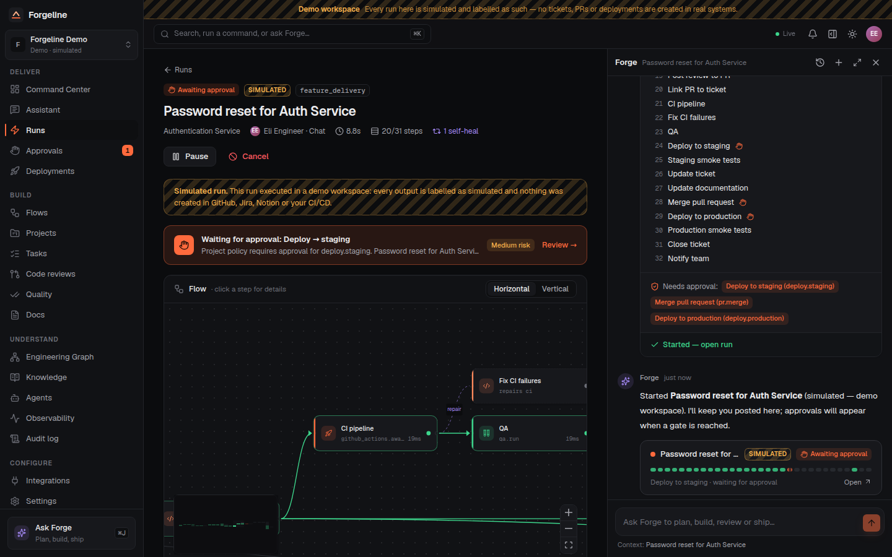
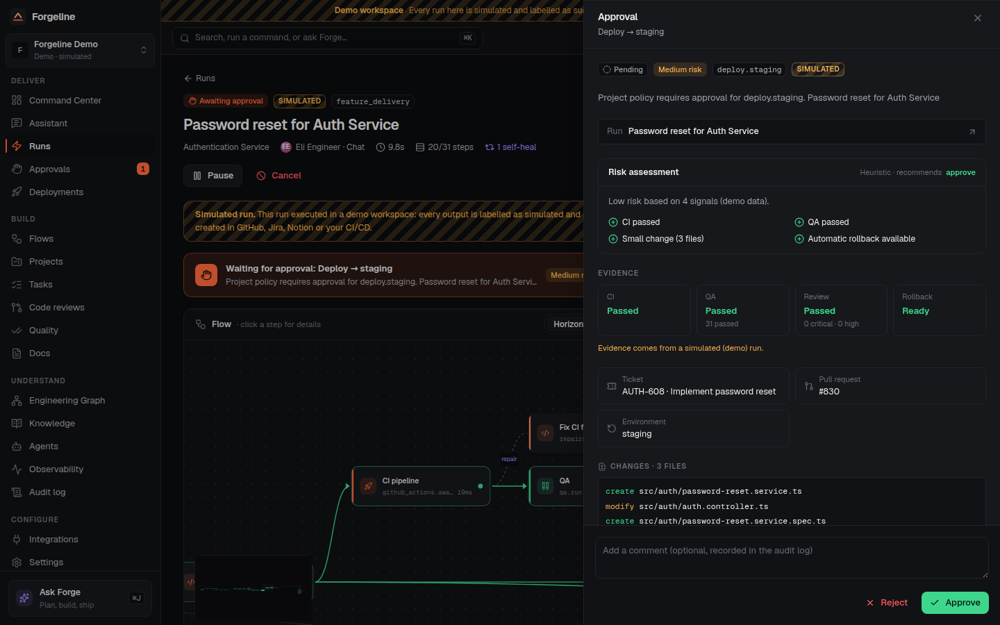
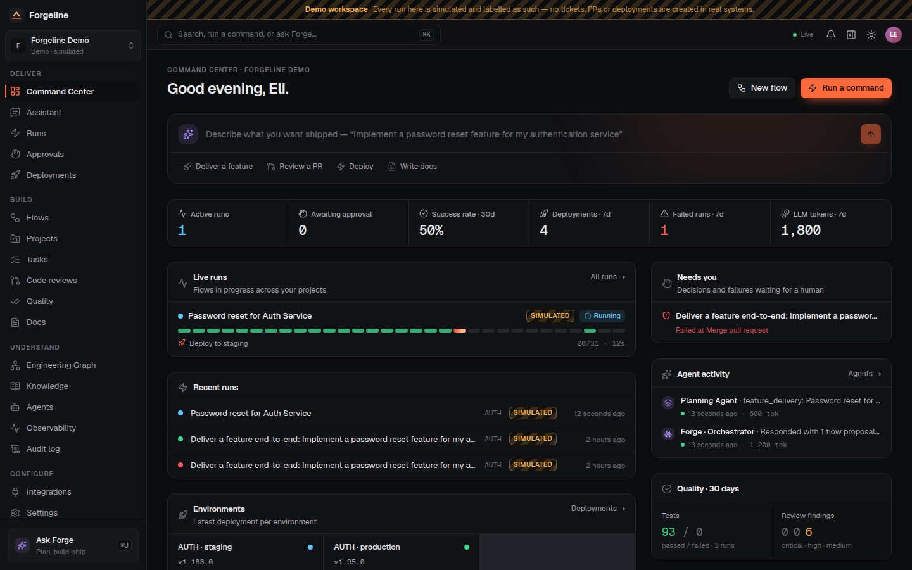
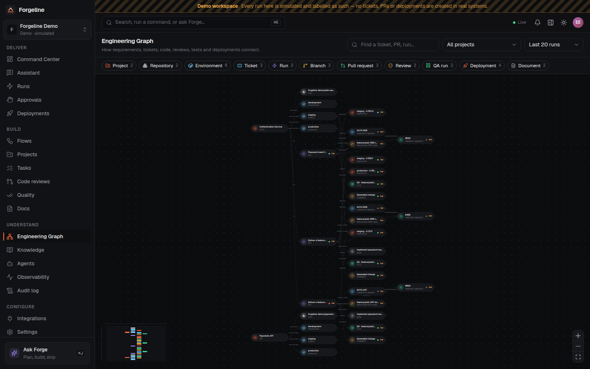
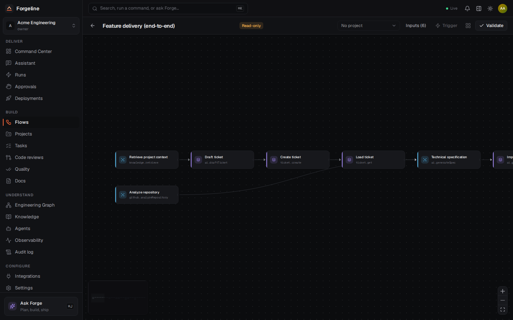
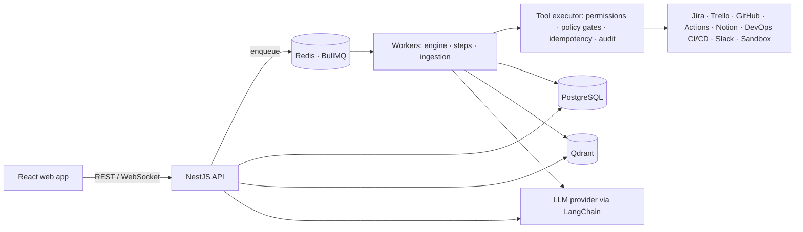

# Forgeline

**An AI-native control plane for the software delivery lifecycle.** Describe an outcome, such as
_"Implement a password reset feature for my authentication service"_. **Forge**, the assistant,
plans it as a **Flow**. Forgeline runs that Flow as a durable **Run** against your real tools:
Jira or Trello, GitHub, GitHub Actions or your own CI/CD, Notion and Slack. The Run stops at
**Gates** for human approval, and every action lands in an audit trail.



| Live run with agents, self-repair and gates       | Approval review with risk, diff, QA and CI context      |
| ------------------------------------------------- | ------------------------------------------------------- |
|             |      |
| **Command Center**                                | **Engineering Graph**                                   |
|  |  |

## What it does

- **Chat, palette, buttons, webhooks: one command layer.** The same commands
  (`feature.deliver`, `pr.review`, `deploy.environment` and others) run from the assistant, ⌘K,
  page actions, `/forgeline review` comments on GitHub PRs, `/forgeline implement` comments on Jira
  issues, and schedules.
- **Durable workflow engine.** Flows are DAGs. They support parallelism, `when` branches, retries
  with backoff, self-repair loops (tests → fix → tests), timeouts, pause, resume and cancel,
  compensation (sagas) and crash recovery. Runs survive process restarts.
- **Autonomous SDLC with honest results.** Agents draft tickets, specs and plans, generate code on
  a branch, and run the repository's **real** lint, typecheck and tests in a sandbox. They repair
  failures, review the diff, open the PR, run CI, run QA, deploy, verify with health checks and
  smoke tests, and roll back on failure. When a step could not run, the result says so.
- **Humans stay in charge.** Production deploys, PR merges and destructive infrastructure actions
  are always gated, with four-eyes approval for production. Gates are injected by policy when a
  tool executes, so editing a Flow cannot remove them. Agents act **as the requesting user** and
  never with more permissions.
- **Grounded AI.** Built on LangChain with OpenAI by default and replaceable. RAG over repositories,
  Jira, Notion, uploaded documents and past Runs, stored in Qdrant. Structured outputs are
  validated with zod. Agents show concise rationale summaries and never hidden chain-of-thought.
- **Premium web app.** Command Center, a global Forge panel (⌘J), a live run graph, a visual Flow
  builder, the Engineering Graph, an approval center, deployments, knowledge, observability and an
  audit log. Dark and light themes, mobile layouts, real-time updates.



## Quick start

The quick start uses Docker for the full stack. Requirements: Docker 24+ with Compose v2.

```bash
cp .env.example .env
# Generate secrets (see docs/SETUP.md for every variable)
sed -i "s|^JWT_SECRET=.*|JWT_SECRET=$(openssl rand -base64 48)|" .env
sed -i "s|^JWT_REFRESH_SECRET=.*|JWT_REFRESH_SECRET=$(openssl rand -base64 48)|" .env
sed -i "s|^ENCRYPTION_KEYS=.*|ENCRYPTION_KEYS=1:$(openssl rand -base64 32)|" .env
sed -i "s|^COOKIE_SECURE=.*|COOKIE_SECURE=true|" .env   # required in production mode; browsers treat localhost as secure
# Optional: OPENAI_API_KEY=sk-... for the assistant and AI steps

SEED=true docker compose up -d --build
open http://localhost:8080
```

For local development (hot reload, infrastructure only in Docker):

```bash
pnpm install
pnpm infra:up            # Postgres, Redis, Qdrant
cp .env.example .env     # then set the secrets as above
pnpm db:deploy && pnpm build:packages && pnpm db:seed
pnpm dev                 # API on :4000, web on :5173
```

See [docs/SETUP.md](docs/SETUP.md) for the details.

### Demo accounts (seed)

| Email                    | Role                         | Password         |
| ------------------------ | ---------------------------- | ---------------- |
| `admin@forgeline.dev`    | Owner                        | `Forgeline!2026` |
| `lead@forgeline.dev`     | Admin (release lead)         | `Forgeline!2026` |
| `engineer@forgeline.dev` | Member (cannot approve prod) | `Forgeline!2026` |

The seed creates two workspaces:

- **Forgeline Demo** is a demo workspace. Every Run there is **simulated** and labelled `DEMO`
  throughout the UI and API. No real tickets, PRs or deployments are created.
- **Acme Engineering** is a real workspace. Connect integrations under _Integrations_ and Runs
  call the real services.

Change the seed password with `SEED_PASSWORD`. Never use the seed accounts in production.

## Architecture at a glance



| Path                       | Contents                                                                                       |
| -------------------------- | ---------------------------------------------------------------------------------------------- |
| `apps/api`                 | NestJS API and workers: auth, RBAC, engine runner, agents, tools, SDLC services, realtime      |
| `apps/web`                 | React 19 + Vite + Tailwind 4 web app                                                           |
| `packages/shared`          | Types, permissions, commands, events and the Flow schema shared by API and web                 |
| `packages/database`        | Prisma schema, migrations and seed                                                             |
| `packages/workflow-engine` | Pure engine: validation, scheduler, safe expression language, templates, backoff               |
| `packages/integrations`    | Provider clients and SDLC tools: Jira, Trello, GitHub, Actions, Notion, DevOps, Slack, HTTP    |
| `packages/ai`              | LangChain providers, prompt registry, structured output schemas, chunking and the vector store |
| `e2e`                      | Mock external services, the API acceptance scenario and Playwright browser tests               |
| `infra`                    | nginx configuration and Docker build helpers                                                   |

## Documentation

| Guide                                      | Covers                                                                  |
| ------------------------------------------ | ----------------------------------------------------------------------- |
| [Architecture](docs/ARCHITECTURE.md)       | System, data, module, agent, workflow and security architecture         |
| [Setup](docs/SETUP.md)                     | Installing, configuring and running Forgeline                           |
| [Development](docs/DEVELOPMENT.md)         | Repository workflow, adding tools and Flows, testing                    |
| [API](docs/API.md)                         | REST conventions, endpoints, realtime events and errors                 |
| [AI agents](docs/AI-AGENT.md)              | Orchestrator, agents, RAG, prompts, providers and safety                |
| [Workflow engine](docs/WORKFLOW-ENGINE.md) | The Flow language, execution semantics, gates, recovery and idempotency |
| [Integrations](docs/INTEGRATIONS.md)       | Connecting providers, webhooks and the custom DevOps CI/CD contract     |
| [Security](docs/SECURITY.md)               | Threat model, auth, secrets, sandboxing and reporting vulnerabilities   |
| [Deployment](docs/DEPLOYMENT.md)           | Docker images, Compose, production configuration and operations         |
| [Contributing](CONTRIBUTING.md)            | How to propose changes                                                  |

## Testing

```bash
pnpm turbo run lint typecheck test build      # unit tests across all packages
pnpm test:integration                          # API against real Postgres + Redis
pnpm --filter @forgeline/e2e test:api          # acceptance scenario through the API
pnpm --filter @forgeline/e2e test:ui           # the same scenario in a real browser (Playwright)
```

The acceptance scenario runs the password-reset story end to end. It uses mock Jira, GitHub,
Notion, DevOps and OpenAI-compatible services, with a real repository fixture whose tests run in
the sandbox. It asserts:

- the side effects that actually reached each service;
- four-eyes approval for production;
- live realtime events;
- audit records;
- tenant isolation.

CI runs all of the above on every pull request (`.github/workflows/ci.yml`).

## Principles

- **Nothing is claimed that did not happen.** If the sandbox is disabled, validation reads
  "not run" and is never shown as passed. Demo runs are labelled. A deploy is reported as
  successful only after health checks pass.
- **No secret leaves the server.** Integration credentials are encrypted at rest with AES-256-GCM
  and rotatable keys. OAuth tokens never reach the browser. Logs and audit entries are redacted.
- **No AI bypass.** Every tool call re-checks the initiating user's permissions at execution time,
  and policy gates are applied outside the Flow definition.
- **Replaceable providers.** The LLM, embeddings, vector store and CI/CD each sit behind an
  interface.

## License

Proprietary. All rights reserved unless a license file states otherwise.
