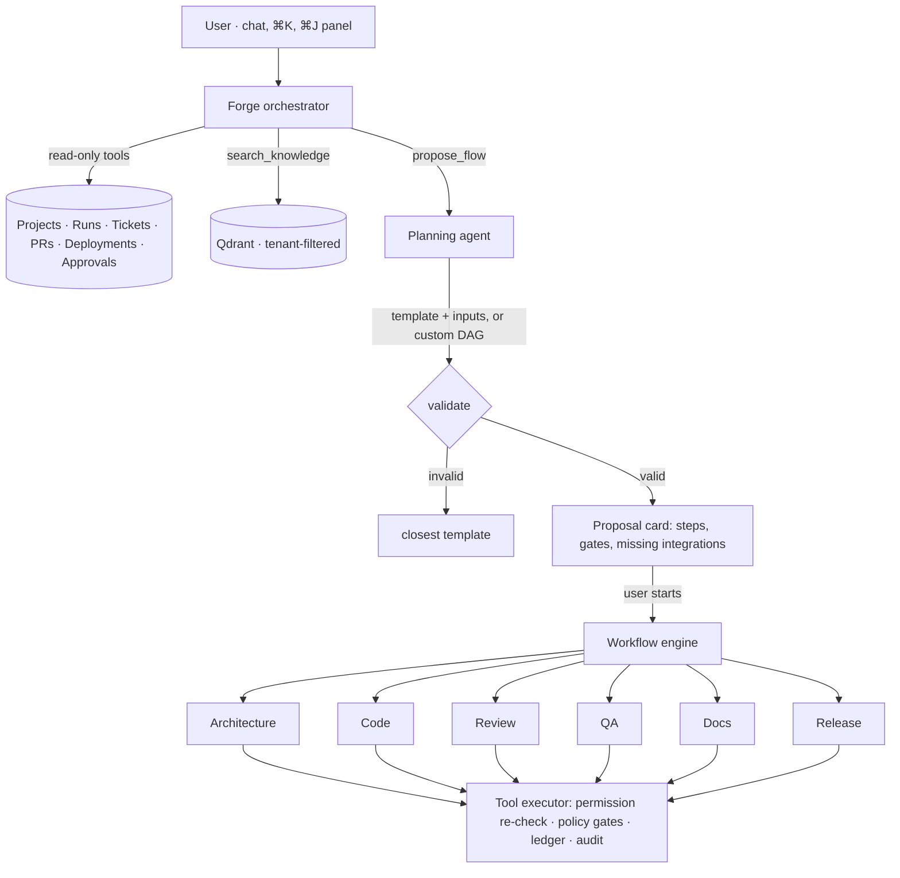

# AI agents

Forgeline's AI layer has one job: turn engineering intent into **durable, governed work**.

Agents read freely within the caller's permissions. They never change the outside world
directly. Every side effect is a Flow step that runs through the workflow engine and the tool
executor. Those enforce permissions, approval gates, idempotency and the audit trail. This page
covers how the agents work, what they can touch, and how to change the model behind them.

## Overview



## Forge, the orchestrator

`apps/api/src/agents/orchestrator.service.ts` is a LangChain tool-calling loop (at most six tool
rounds) with token streaming.

| Tool                     | Effect                                                                               |
| ------------------------ | ------------------------------------------------------------------------------------ |
| `list_projects`          | Projects with repositories and environments the user can read                        |
| `search_knowledge`       | RAG over the organization's knowledge (narrowed to a project when one is in context) |
| `list_runs`, `get_run`   | Recent Runs and their step status                                                    |
| `get_ticket`             | Reads a Jira or Trello ticket through the connected integration                      |
| `list_pull_requests`     | Open PRs for a project's repository                                                  |
| `list_pending_approvals` | Gates waiting for a decision                                                         |
| `list_deployments`       | Deployment history                                                                   |
| `propose_flow`           | **The only action tool.** It plans a Flow and returns a proposal                     |

How `propose_flow` behaves:

- By default it produces a **proposal** that the user reviews and starts. The card shows:
  - every step and which agent runs it;
  - which gates will apply, for example `deploy.production`, four-eyes;
  - which integrations are missing.
- It starts immediately only when the user explicitly asked for that, and only if every required
  integration is connected.
- Starting is idempotent per proposal (`proposal:<id>`), so a double click cannot start two Runs.

Every tool re-checks the user's permissions. A user without `workflow:execute` in a project
gets a "permission denied" tool result, and Forge explains that rather than working around it.

**Context.** The system prompt includes:

- the organization;
- the current page (`pageContext`): the Run, project or PR on screen, so "retry this" works;
- the user's projects;
- in demo workspaces, an explicit instruction that every result is simulated.

**Memory.**

- Short-term memory is the last 40 completed turns.
- Once a conversation passes 30 messages, a fast model rewrites a rolling summary of the older
  turns every 10 messages.
- Long-term memory is the knowledge base. Completed and failed Runs are ingested automatically,
  so "what happened with the last auth deploy?" works.

**Streaming.** Tokens stream to the conversation room as `agent.message.delta`, and tool activity
as `agent.tool.started` and `agent.tool.completed`. The final message is persisted with
structured parts: text, proposal cards, run cards and sources. Generation can be cancelled at
any time.

**Without an AI provider**, Forge does not pretend. It says the provider is not configured, and
it matches actionable requests to a template by keywords, saying that it did so (`source:
'keyword'`).

## Planning

`PlannerService` asks the planner model for a `flowPlanSchema` object. That object is either a
**template key plus inputs** (preferred) or a **custom step list**.

The output is merged with defaults and validated by the same validator the Flow builder uses
(DAG, registered tools, templates, expressions). It is then annotated with:

- the approvals the policy engine will require. These are evaluated against the project's real
  environments, so a staging deploy shows `deploy.staging` and a production deploy shows
  `deploy.production`;
- the integrations that are not connected.

An invalid custom plan is never executed. The planner falls back to the closest template and
says so.

## Specialised agents

Agents are personas that group tools and select a model role. Each Flow step records the agent
that ran it, which drives the run visualisation and the Agents page.

| Agent        | Model role | Tools                                                                          |
| ------------ | ---------- | ------------------------------------------------------------------------------ |
| Planning     | planner    | `ai.draftTicket`, `ai.generateSpec`, `ai.generatePlan`                         |
| Architecture | planner    | `github.analyzeRepository`, `knowledge.retrieve`                               |
| Code         | coder      | `code.generate`, `code.validate`, `code.fix`, `code.commit`                    |
| Review       | reviewer   | `code.review`, `code.publishReview`                                            |
| QA           | coder      | `qa.run` (derives cases, runs the suite, analyses failures)                    |
| Docs         | planner    | `docs.generate`, `notion.createPage`                                           |
| Release      | fast       | `devops.runPipeline`, `deploy.environment`, `deploy.verify`, `deploy.rollback` |

### Code generation and self-repair

1. `code.generate` builds context: repository analysis, relevant files from code search and
   knowledge, the spec and the plan. It asks the coder model for a `codeChangeSetSchema` (full
   file contents, with rationale per file) and stores it as a `CodeGeneration`.
2. `code.validate` checks out the branch with the changes applied in the **sandbox**. It runs
   the repository's own install, lint, typecheck and test commands (configured per repository).
   Real output and exit codes are recorded.
3. On failure, the Flow's `repair` loop runs `code.fix` with the real failure output, and then
   re-validates. The loop runs at most `maxIterations` times; the default template uses 3.
4. Validation never claims success it did not observe:
   - a command that could not run is `skipped`, with the reason;
   - a disabled sandbox makes the whole validation "not run";
   - a repository without `tsconfig.json` skips typecheck with that explanation.

### Review

`code.review` reviews the actual diff against the base branch. It returns `reviewResultSchema`
findings with severity (`CRITICAL` to `INFO`), category (correctness, security, performance,
error handling, tests, types, concurrency, …), file and line. `code.publishReview` posts them to the PR. Blocking findings can feed the
`address_review` repair step.

### QA

`qa.run` derives a test plan (`qaTestPlanSchema`) from the requirement and the diff. It runs the
suite in the sandbox. When there are failures, it asks for a structured `failureAnalysisSchema`
root cause. The report counts only tests that actually executed.

## Retrieval (RAG)

| Stage     | Implementation                                                                                                                                                                                  |
| --------- | ----------------------------------------------------------------------------------------------------------------------------------------------------------------------------------------------- |
| Sources   | GitHub repositories (code and docs), Jira issues, Notion pages, uploads, URLs, completed Runs                                                                                                   |
| Parsing   | Binary detection, NUL stripping, whitespace normalisation, deduplication by content hash                                                                                                        |
| Chunking  | Language-aware splitting for code (by extension), heading-aware for Markdown, recursive for text; line ranges and nearest heading or symbol kept for citations                                  |
| Embedding | `OPENAI_EMBEDDING_MODEL` (1536 dimensions by default), batched                                                                                                                                  |
| Storage   | Qdrant. Deterministic point IDs (`documentId:chunkIndex`) make re-indexing overwrite, not duplicate                                                                                             |
| Retrieval | `KnowledgeRetriever` (a LangChain `BaseRetriever`) with an **immutable tenant filter**: `organizationId` always, `projectId` when given; k = 8 by default (6 for the orchestrator), score ≥ 0.2 |
| Citation  | Results carry the document, source URL and line range. The UI renders them as sources                                                                                                           |

Ingestion runs on the worker queue (`knowledge.ingest`) and reports status per document
(`knowledge.document.status`).

## Prompts and structured output

- Prompts live in a versioned registry (`packages/ai/src/prompts/registry.ts`): orchestrator,
  flow planning, ticket, spec, plan, code generate and fix, review, QA plan and failure analysis,
  docs, risk assessment, PR description, workflow generation, command routing, and conversation
  summary and title. Each prompt carries a `version`. Bump it whenever you change the prompt.
- Structured output uses zod schemas (`packages/ai/src/schemas.ts`) through
  `withStructuredOutput` with JSON Schema. `invokeStructured` re-validates the result, retries a
  malformed response with the validation error, and records token usage.
- Agents return concise `summary` and `rationale` fields meant for people. Hidden reasoning is
  never requested, stored or shown.

## Observability

Every agent invocation is an `AgentRun` that records:

- the agent and the model;
- prompt and completion tokens;
- duration, status and a short summary.

These feed the Agents and Observability pages and the `forgeline_llm_*` Prometheus metrics. LLM
errors are classified (`rate_limit`, `auth`, `timeout`, …) and surfaced on the step.

## Changing the model provider

The LLM is behind `LlmProvider` (`packages/ai/src/provider.ts`):

```ts
interface LlmProvider {
  isConfigured(): boolean;
  modelName(role: ModelRole): string; // orchestrator | planner | coder | reviewer | fast
  chatModel(role: ModelRole, options?): BaseChatModel;
  embeddings(): EmbeddingsInterface;
  readonly embeddingDimensions: number;
}
```

- **OpenAI-compatible gateways** (Azure OpenAI, vLLM, LiteLLM and others): set `OPENAI_BASE_URL`
  and the model names.
- **Another vendor**: implement `LlmProvider` with any LangChain chat model (for example
  `@langchain/anthropic`). Bind it to the `LLM_PROVIDER` token in `apps/api/src/ai/ai.module.ts`. Nothing
  else changes, because agents ask for roles, never for vendors.
- **The vector store** is behind `VectorStore` (`packages/ai/src/rag/vector-store.ts`), with
  Qdrant as the default implementation.

If you change the embedding model or dimensions, re-index the knowledge base
(`POST /api/knowledge/documents/:id/reindex`, or re-add the sources).

## Safety properties

| Property                      | How it is enforced                                                                                                                      |
| ----------------------------- | --------------------------------------------------------------------------------------------------------------------------------------- |
| No privilege escalation       | Agents act as the requesting user. `ToolExecutor` re-checks permissions when each step executes                                         |
| No ungated sensitive actions  | Policy gates are injected at tool execution, outside the Flow and outside the model's control                                           |
| No cross-tenant retrieval     | The tenant filter is fixed when the retriever is constructed                                                                            |
| No secrets in prompts         | Agents never see credentials. Clients are built server-side, and tool output is redacted before persistence                             |
| Prompt injection from content | Retrieved text, tickets and PR comments are data. They can at most influence a _proposal_, which a human reviews, and gates still apply |
| No fabricated results         | Results come from tool output only. Demo runs are flagged; unrun validation is "not run"                                                |
