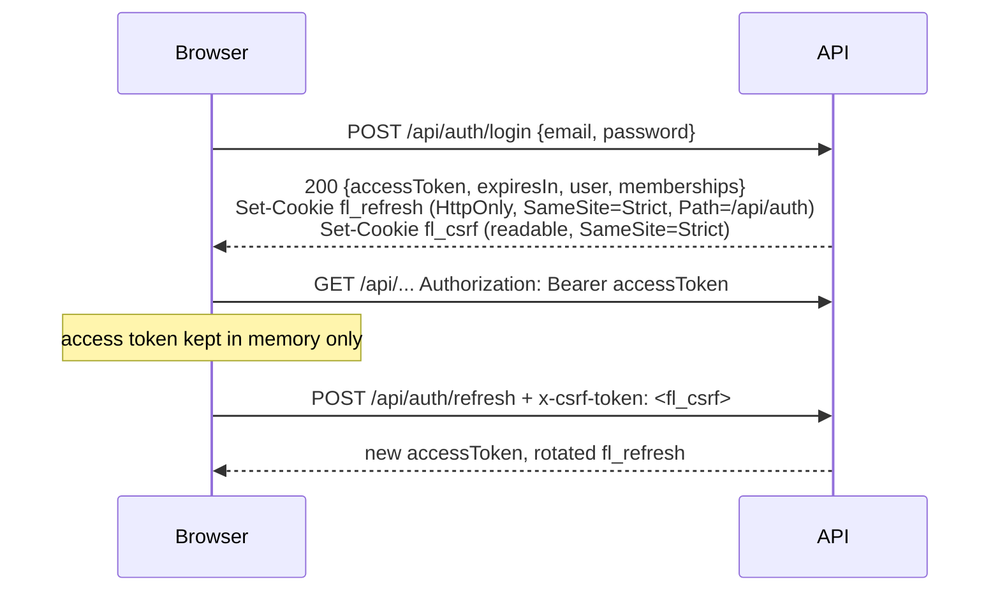

# API

Forgeline exposes a REST API under `/api` and a Socket.IO namespace at `/realtime`. The web app
uses exactly these APIs. Nothing is private to the UI.

Set `SWAGGER_ENABLED=true` to serve the full, generated OpenAPI document at `/api/docs`
(interactive) and `/api/openapi.json`. This page explains the conventions and gives a map of the
endpoints.

## Conventions

| Aspect           | Convention                                                                                                                                  |
| ---------------- | ------------------------------------------------------------------------------------------------------------------------------------------- |
| Base path        | `/api`. Exceptions: `/health`, `/health/ready` and `/metrics`                                                                               |
| Auth             | `Authorization: Bearer <accessToken>` (JWT, HS256, 15 minutes by default)                                                                   |
| Organization     | `x-organization-id: <uuid>` selects the workspace. If omitted, the user's first membership is used                                          |
| Request IDs      | Send `x-request-id` to correlate a request; one is generated otherwise and echoed in errors and logs                                        |
| Validation       | Unknown properties are rejected (`whitelist` + `forbidNonWhitelisted`)                                                                      |
| Pagination       | `?page=1&pageSize=25` (maximum 100) → `{ items, total, page, pageSize }`                                                                    |
| Rate limits      | `RATE_LIMIT_MAX` per `RATE_LIMIT_TTL_SECONDS` per client; auth endpoints use `AUTH_RATE_LIMIT_MAX` per minute; exceeding them returns `429` |
| IDs / timestamps | UUIDs; ISO-8601 UTC                                                                                                                         |

### Errors

Every error uses the same envelope:

```json
{
  "statusCode": 403,
  "error": "Forbidden",
  "message": "Missing permission \"deploy:production\" for this project",
  "code": "PERMISSION_DENIED",
  "requestId": "9b0c…"
}
```

`code` is stable and machine-readable. `details` appears only when there is something to add.
Common values:

- `VALIDATION_FAILED`: `details` lists the field errors.
- `PERMISSION_DENIED`: the caller lacks a permission. The denial is also recorded in the audit log.
- `INVALID_WORKFLOW`: `details` lists the issues by path.
- `NOT_FOUND`, `UNIQUE_VIOLATION`, `CSRF_FAILED` and `INVALID_SIGNATURE`.
- `TOOL_<KIND>`: a tool failure surfaced synchronously.

Resources in another organization return `404`, not `403`, so their existence does not leak.

## Authentication



| Endpoint                         | Notes                                                                                                                                                          |
| -------------------------------- | -------------------------------------------------------------------------------------------------------------------------------------------------------------- |
| `POST /api/auth/register`        | Creates a user and their workspace (owner)                                                                                                                     |
| `POST /api/auth/login`           | Constant-time behaviour for unknown emails                                                                                                                     |
| `POST /api/auth/accept-invite`   | Creates the account for an invitation token (existing users accept from their workspace list)                                                                  |
| `POST /api/auth/refresh`         | Requires the `fl_refresh` cookie and the `x-csrf-token` header (double submit). Refresh tokens rotate; reuse of a rotated token revokes the whole token family |
| `POST /api/auth/logout`          | Revokes the session and clears cookies                                                                                                                         |
| `GET /api/auth/me`               | Current user, memberships, active organization and effective permissions                                                                                       |
| `POST /api/auth/change-password` | Revokes **all** sessions                                                                                                                                       |

Service accounts and scripts can use the same flow: log in, then send the bearer token.

## Endpoint map

The permission listed is the one checked. Project-scoped permissions also consider the caller's
project role.

### Organization and people

| Method and path                                                                  | Permission                    |
| -------------------------------------------------------------------------------- | ----------------------------- |
| `GET/PATCH /api/organizations/current`                                           | `org:read` / `org:manage`     |
| `GET /api/organizations/current/members`                                         | `org:read`                    |
| `PATCH/DELETE /api/organizations/current/members/:id`                            | `members:manage`              |
| `POST /api/organizations/current/invitations`, `DELETE …/:id`                    | `members:manage`              |
| `GET/POST /api/organizations/current/teams`, `PUT …/:id/members`, `DELETE …/:id` | `org:read` / `members:manage` |
| `GET/PATCH /api/users/me`                                                        | authenticated                 |

### Projects

| Method and path                                                           | Permission       |
| ------------------------------------------------------------------------- | ---------------- |
| `GET /api/projects`, `GET /api/projects/:projectId`                       | `project:read`   |
| `POST /api/projects`                                                      | `project:create` |
| `PATCH/DELETE /api/projects/:projectId`                                   | `project:manage` |
| `PUT /api/projects/:projectId/members`, `DELETE …/members/:userId`        | `project:manage` |
| `POST/PATCH/DELETE /api/projects/:projectId/repositories[/:repositoryId]` | `project:manage` |
| `POST/PATCH /api/projects/:projectId/environments[/:environmentId]`       | `project:manage` |
| `GET /api/repositories`                                                   | `project:read`   |
| `GET /api/graph`: Engineering Graph (nodes and edges)                     | `project:read`   |
| `GET /api/dashboard`                                                      | `project:read`   |

### Integrations

| Method and path                                      | Permission           | Notes                                                                          |
| ---------------------------------------------------- | -------------------- | ------------------------------------------------------------------------------ |
| `GET /api/integrations/providers`                    | `integration:read`   | Catalog: auth methods and availability                                         |
| `GET /api/integrations`, `GET /api/integrations/:id` | `integration:read`   | Never includes credentials                                                     |
| `POST /api/integrations/:provider/connect`           | `integration:manage` | Token-based connection. Verified before saving                                 |
| `POST /api/integrations/:provider/oauth/start`       | `integration:manage` | Returns the authorization URL (state + PKCE)                                   |
| `GET /api/integrations/oauth/:provider/callback`     | public (state-bound) | Provider redirect target                                                       |
| `POST /api/integrations/trello/complete`             | `integration:manage` | Completes Trello's token flow                                                  |
| `POST /api/integrations/:id/health`                  | `integration:read`   | Calls the provider for real                                                    |
| `POST /api/integrations/:id/webhooks`                | `integration:manage` | Creates an inbound webhook, registered automatically where the provider allows |
| `DELETE /api/integrations/:id`                       | `integration:manage` | Revokes and deletes the credentials                                            |
| `GET /api/integrations/github/repositories`          | `integration:read`   | Repositories visible to the connection                                         |

### Flows and Runs

| Method and path                                                    | Permission                              |
| ------------------------------------------------------------------ | --------------------------------------- |
| `GET /api/workflows/templates`, `POST …/templates/:key/clone`      | `workflow:read` / `workflow:manage`     |
| `POST /api/workflows/validate`                                     | `workflow:read`                         |
| `POST /api/workflows/generate`: Flow from a description (AI)       | `workflow:manage` + `agent:use`         |
| `GET/POST /api/workflows`, `GET/PATCH/DELETE /api/workflows/:id`   | `workflow:read` / `workflow:manage`     |
| `POST /api/workflows/:id/status` (activate or archive)             | `workflow:manage`                       |
| `POST /api/workflows/:id/run` `{ projectId?, inputs }`             | `workflow:execute`                      |
| `POST /api/workflows/:id/triggers`, `DELETE …/triggers/:triggerId` | `workflow:manage`                       |
| `GET /api/workflow-executions`, `GET …/:id`, `GET …/:id/logs`      | `workflow:read`                         |
| `POST /api/workflow-executions/:id/{pause,resume,cancel,rollback}` | `workflow:execute` on the Run's project |
| `POST /api/workflow-executions/:id/steps/:stepId/retry`            | `workflow:execute`                      |
| `GET /api/artifacts/:id`, `PATCH /api/artifacts/:id`               | `workflow:read` / `workflow:execute`    |
| `GET /api/tools`: the tool registry with JSON Schemas              | `workflow:read`                         |

### Approvals

| Method and path                                             | Permission                                                                                                    |
| ----------------------------------------------------------- | ------------------------------------------------------------------------------------------------------------- |
| `GET /api/approvals?status=&projectId=`                     | `workflow:read`                                                                                               |
| `GET /api/approvals/:id`                                    | `workflow:read`. Includes the review context: changes, QA, CI, risk                                           |
| `GET /api/approvals/policy?projectId=`                      | `project:read`. The effective policy, with locked actions marked                                              |
| `POST /api/approvals/:id/approve` / `reject` `{ comment? }` | The gate's required permission (for example `deploy:production`). Self-approval of four-eyes gates is refused |

### Commands and the assistant

| Method and path                                                            | Permission               | Notes                                                                                               |
| -------------------------------------------------------------------------- | ------------------------ | --------------------------------------------------------------------------------------------------- |
| `GET /api/commands`                                                        | `workflow:read`          | Commands available to the caller                                                                    |
| `POST /api/commands/route` `{ query, pageContext? }`                       | `workflow:read`          | Natural language → ranked commands with prefilled inputs                                            |
| `POST /api/commands/:id/execute` `{ projectId?, inputs, idempotencyKey? }` | the command's permission | Starts the Run. A repeated `idempotencyKey` returns the same Run                                    |
| `GET/POST /api/conversations`, `GET/PATCH /api/conversations/:id`          | `agent:use`              |                                                                                                     |
| `POST /api/conversations/:id/messages` `{ content, pageContext? }`         | `agent:use`              | Returns `{ userMessage, assistantMessage }` at once; the reply streams over realtime. 30 per minute |
| `POST /api/conversations/:id/cancel`                                       | `agent:use`              | Stops generation                                                                                    |
| `GET /api/conversations/:id/proposals/:proposalId`                         | `agent:use`              |                                                                                                     |
| `POST …/proposals/:proposalId/start` `{ inputs? }`                         | `workflow:execute`       | Returns `{ execution, message }`                                                                    |
| `POST …/proposals/:proposalId/dismiss`                                     | `agent:use`              |                                                                                                     |
| `GET /api/agents`, `GET /api/agents/runs[/:id]`                            | `workflow:read`          | Agent catalog, runs, token usage                                                                    |

### SDLC records

| Method and path                                                         | Permission                      |
| ----------------------------------------------------------------------- | ------------------------------- |
| `GET /api/tasks`, `POST /api/tasks`, `PATCH /api/tasks/:id`             | `project:read` / `ticket:write` |
| `GET /api/code-generation[/:id]`                                        | `project:read`                  |
| `GET /api/code-review[/:id]`                                            | `project:read`                  |
| `GET /api/qa/runs[/:id]`                                                | `project:read`                  |
| `GET /api/deployments[/:id]`, `GET /api/deployments/environments`       | `project:read`                  |
| `GET /api/documents`, `POST /api/documents`, `PATCH /api/documents/:id` | `project:read` / `docs:write`   |

### Knowledge

| Method and path                                                                        | Permission         |
| -------------------------------------------------------------------------------------- | ------------------ |
| `GET /api/knowledge/documents[/:id]`, `GET /api/knowledge/stats`                       | `knowledge:read`   |
| `POST /api/knowledge/search` `{ query, projectId?, k?, documentTypes?, sourceTypes? }` | `knowledge:read`   |
| `POST /api/knowledge/documents` (text), `/upload` (multipart), `/url`                  | `knowledge:manage` |
| `POST /api/knowledge/sources/{github,jira,notion}`                                     | `knowledge:manage` |
| `POST /api/knowledge/documents/:id/reindex`, `DELETE /api/knowledge/documents/:id`     | `knowledge:manage` |

### Operations

| Method and path                                                                                           | Permission / auth                                                            |
| --------------------------------------------------------------------------------------------------------- | ---------------------------------------------------------------------------- |
| `GET /api/audit?page=&pageSize=&action=&resourceType=&actorId=&projectId=&executionId=&status=&from=&to=` | `audit:read`                                                                 |
| `GET /api/observability/summary`                                                                          | `observability:read`                                                         |
| `GET /api/notifications`, `GET …/unread-count`, `POST …/read`                                             | authenticated (own notifications only)                                       |
| `GET /health`                                                                                             | public: liveness                                                             |
| `GET /health/ready`                                                                                       | public: Postgres, Redis and Qdrant checks; `503` when a required check fails |
| `GET /metrics`                                                                                            | Prometheus. Requires `Authorization: Bearer $METRICS_TOKEN` when set         |

### Webhooks (inbound)

`POST /api/webhooks/:provider/:webhookId` is public, authenticated by signature, and
deduplicated by delivery ID. See [Integrations](INTEGRATIONS.md#webhooks).

## Realtime

Connect to the `/realtime` namespace with the access token:

```ts
import { io } from 'socket.io-client';

const socket = io(`${origin}/realtime`, {
  path: '/socket.io',
  auth: { token: accessToken, organizationId },
  transports: ['websocket'],
});
socket.on('ready', ({ organizationId }) => {
  socket.emit('subscribe', { executionId }); // fine-grained streams; ack: { ok: true }
});
socket.on('event', (e: DomainEvent) => {
  /* … */
});
```

Every socket joins its **organization** room and its **user** room. High-volume streams are
delivered only to sockets that subscribe to that resource. The server checks that the resource
belongs to the socket's organization, and that conversations belong to the user. These streams
are:

- `agent.message.delta` and the `agent.tool.*` events, for a conversation;
- `workflow.log` and `workflow.step.progress`, for a Run.

Events share one envelope (`DomainEvent` in `packages/shared/src/events.ts`):

```json
{
  "id": "…",
  "type": "workflow.step.completed",
  "organizationId": "…",
  "projectId": "…",
  "executionId": "…",
  "occurredAt": "2026-10-05T12:00:00.000Z",
  "data": { "stepKey": "run_tests", "status": "COMPLETED", "summary": "42 tests passed", "durationMs": 18231 }
}
```

| Family      | Types                                                                                                                  |
| ----------- | ---------------------------------------------------------------------------------------------------------------------- |
| Runs        | `workflow.{started,status,completed,failed,cancelled,paused,resumed,log}`                                              |
| Steps       | `workflow.step.{queued,started,progress,completed,failed,skipped,retrying,repairing,waiting_approval}`                 |
| Approvals   | `approval.{requested,granted,rejected}`                                                                                |
| Deployments | `deployment.{started,progress,completed,failed,rolled_back}`                                                           |
| SDLC        | `code.generated`, `code.reviewed`, `qa.started`, `qa.completed`                                                        |
| Agents      | `agent.run.{started,completed}`, `agent.message.{delta,completed}`, `agent.tool.{started,completed}`, `agent.activity` |
| Other       | `notification.created` (user room), `integration.status`, `knowledge.document.status`                                  |

Events are notifications, not the source of truth. After reconnecting, refetch the resource over
REST. The web app does this automatically.
