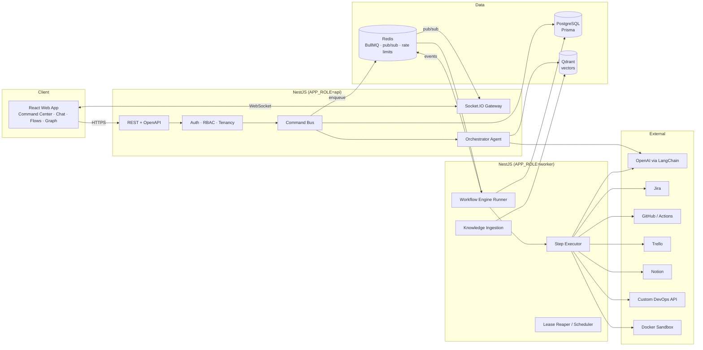
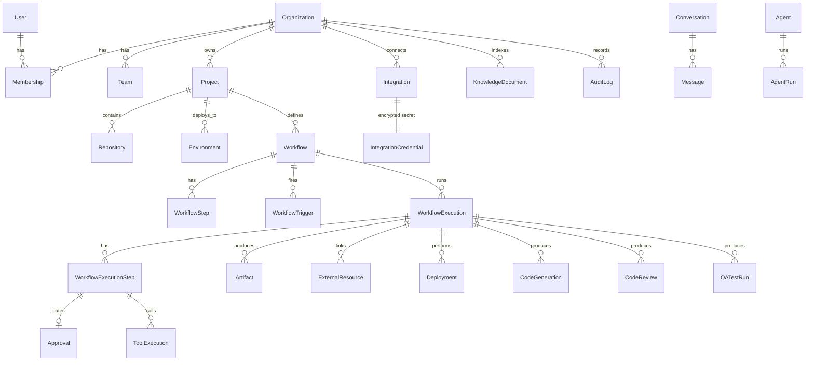
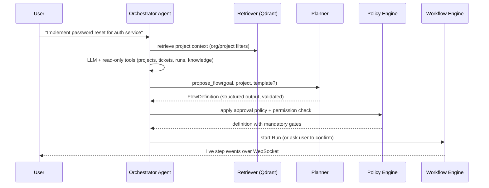
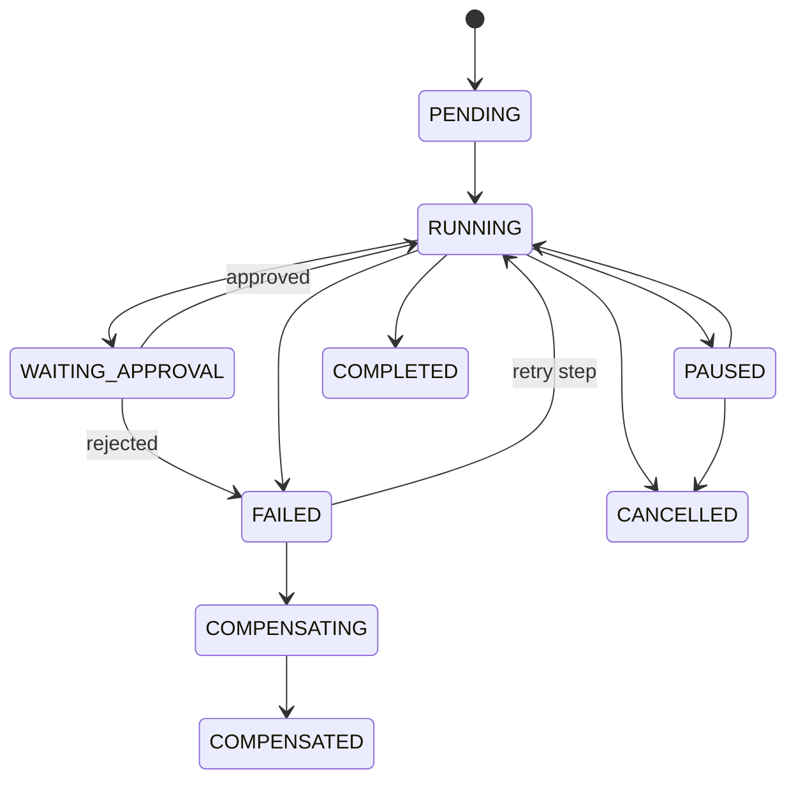

# Vanshil's SDLC — Architecture

> **Vanshil's SDLC** is an AI-native engineering control plane. Engineers describe an
> outcome ("ship password reset to staging"), and the platform's agents plan it as a
> **Flow**, execute it as a durable **Run**, call real tools (Jira, GitHub,
> GitHub Actions, Trello, Notion, your CI/CD), stop at **Gates** for human
> approval, and record every action in an audit trail.

This document is both the Phase 1 analysis and the Phase 2 architecture plan. It
is kept up to date with the implementation. Topic guides: [Workflow engine](WORKFLOW-ENGINE.md),
[AI agents](AI-AGENT.md), [Integrations](INTEGRATIONS.md), [Security](SECURITY.md),
[API](API.md), [Deployment](DEPLOYMENT.md).

---

## 1. Phase 1 — Repository analysis

| Area                 | Finding                                                                                                                                                   |
| -------------------- | --------------------------------------------------------------------------------------------------------------------------------------------------------- |
| Current architecture | None. The repository was empty (no commits, no files).                                                                                                    |
| Existing components  | None.                                                                                                                                                     |
| Reusable components  | None — greenfield.                                                                                                                                        |
| Problems             | No constraints to preserve; the risk is the opposite: scope. Every layer (data model, engine, AI, integrations, UI) must be built and validated together. |
| Missing components   | Everything: monorepo tooling, backend, frontend, schema, engine, agents, adapters, infra, CI, docs.                                                       |
| Environment          | Node 22, pnpm 10, Docker (Postgres 16, Redis 7, Qdrant 1.x verified running), Chromium for Playwright.                                                    |

**Recommended architecture:** a pnpm + Turborepo monorepo with a NestJS API
(that also runs background workers), a React/Vite web app, and framework-agnostic
packages for the parts that must stay replaceable and unit-testable in isolation
(workflow engine, integrations, AI). Details follow.

---

## 2. System architecture



### Monorepo layout

```
apps/
  api/                 NestJS application (REST, WebSockets, workers)
  web/                 React + Vite + Tailwind application
packages/
  shared/              Types, enums, event names, permissions, zod schemas shared by api & web
  database/            Prisma schema, migrations, client factory, seed
  workflow-engine/     Pure, persistence-agnostic engine: validation, scheduling,
                       expressions, templating, retry/backoff
  integrations/        Provider HTTP clients + SDLC tool adapters (Jira, Trello,
                       GitHub, GitHub Actions, Notion, Custom DevOps, Slack)
  ai/                  LangChain abstractions: LLM/embedding providers, prompts,
                       structured output schemas, chunking, vector store port
  config/              Shared tsconfig presets
e2e/                   Mock external services, API acceptance scenario, Playwright tests
infra/                 nginx config, Docker build helpers (Dockerfiles live in apps/*)
docs/                  Topic documentation
```

Why packages instead of everything in `apps/api`: the engine, integrations and
AI layer have **no NestJS dependency**, so they are unit-tested in milliseconds,
and providers are replaceable through interfaces (requirements 23–26). The UI
design system lives in `apps/web/src/components/ui` because only one frontend
consumes it.

### Process model

One NestJS codebase, two roles selected by `APP_ROLE`:

- `api` — HTTP, WebSocket gateway, agent chat.
- `worker` — BullMQ processors (workflow advance, step execution, ingestion),
  lease reaper, cron triggers.
- `all` (default in development) — both.

Events produced anywhere are published on Redis (`forgeline:events`) and every
API instance relays them to its Socket.IO rooms, so workers and the gateway can
scale independently.

---

## 3. Database architecture

PostgreSQL is the system of record; Prisma owns migrations. All tenant-owned
tables carry `organizationId` and are indexed on it. UUID primary keys,
`createdAt/updatedAt` everywhere, `deletedAt` soft delete on user-facing
entities (projects, integrations, workflows, documents, knowledge).



Key decisions:

- **Credentials** live only in `IntegrationCredential.ciphertext`, AES-256-GCM
  with a versioned key from the `SecretsProvider` abstraction (env-backed by
  default; swap for KMS/Vault). Tokens never leave the API process.
- **Executions snapshot their definition** (`WorkflowExecution.definition`), so
  editing a Flow never mutates in-flight Runs.
- **Optimistic concurrency + row locks.** The engine advances a Run inside a
  transaction holding `SELECT … FOR UPDATE` on the execution row; step state
  transitions use conditional updates (`WHERE status = expected`) so duplicate
  job deliveries are no-ops.
- **Idempotency ledger.** `ToolExecution(organizationId, idempotencyKey)` is
  unique. Keys are derived from `executionId + stepKey + iteration`, so a retry
  of "Create Jira ticket" returns the recorded result instead of creating a
  second ticket. Adapters additionally _find-before-create_ using natural keys
  (Jira label, branch name, PR head, Notion marker) to cover crashes between the
  external call and the ledger write.
- **Audit log** is append-only, redacted (secrets/tokens stripped by key name
  and pattern) before write.

---

## 4. Module architecture (API)

```
apps/api/src/
  main.ts / app.module.ts / worker.module wiring
  common/            config, logging (pino + request/run IDs), errors, guards,
                     decorators, crypto, redaction, pagination, prisma service
  auth/              register/login, JWT access + rotating refresh tokens,
                     CSRF double-submit for cookie endpoint
  users/ organizations/ teams/ projects/ repositories/ environments/
  rbac/              role → permission map, PermissionGuard, PolicyService
  integrations/      connection lifecycle, OAuth (state + PKCE), credential vault,
                     token refresh, health checks, provider registry
  tools/             ToolRegistry, ToolExecutor (permission check, idempotency
                     ledger, timeout, retry classification, audit)
  workflows/         Flow CRUD, versioning, templates, triggers, AI generation
  workflow-execution/ Run lifecycle, engine runner, step handlers, approvals
                     integration, recovery
  approvals/         Gates, policy evaluation, decisions, risk assessment
  agents/            Orchestrator, planner, specialised agents, agent runs
  conversations/     Chat persistence + streaming
  knowledge/         Ingestion pipeline, retrieval, Qdrant
  sdlc/              code-generation, code-review, qa, deployments, documentation
  sandbox/           SandboxRunner (Docker / local-dev) for lint/test/build
  commands/          "Do anything from anywhere" command bus + NL routing
  graph/             Engineering Graph projection
  notifications/     in-app + Slack
  audit/  webhooks/  events/ (Redis pub/sub + Socket.IO gateway)  queues/
  observability/     metrics (Prometheus), dashboards, error reporter
```

### Commands — "do anything from anywhere"

Business actions are **commands** (`feature.deliver`, `ticket.create`,
`code.generate`, `pr.review`, `qa.run`, `ci.run`, `deploy.environment`,
`deploy.rollback`, `docs.generate`, `team.notify`, …; see `packages/shared/src/commands.ts`). Every
entry point — chat, command palette, page buttons, Jira/GitHub webhooks,
schedules — dispatches the same command through `CommandBus`, which checks
permissions, resolves the Flow template, and starts a Run. No business logic
lives in React components or controllers.

---

## 5. Agent architecture



- **LLM abstraction** (`packages/ai`): `LlmProvider` returns LangChain
  `BaseChatModel`s by _role_ (`orchestrator`, `planner`, `coder`, `reviewer`,
  `fast`) mapped from env (`OPENAI_MODEL`, `OPENAI_MODEL_FAST`, …). OpenAI is the
  default implementation; any LangChain chat model can be plugged in.
- **Prompts** are versioned `ChatPromptTemplate`s in a registry.
- **Structured outputs** use zod schemas + `withStructuredOutput` (flow plans,
  specs, code changes, review findings, QA cases, root-cause analysis, risk
  assessment).
- **Tool calling**: the orchestrator binds _read-only_ tools directly and one
  _action_ tool, `propose_flow`. Side effects always go through the workflow
  engine, so they are durable, approvable, idempotent and audited.
- **Memory**: conversation window + rolling summary stored on the
  Conversation; long-term memory is the knowledge base (past Runs are ingested).
- **Reflection**: code generation runs a validate → repair loop driven by real
  lint/test output; review findings feed a fix step.
- **Reasoning transparency**: agents return concise `summary` fields
  (decision + rationale), never hidden chain-of-thought.
- **Authorization**: agents run _as the user_. Every tool invocation is checked
  against the initiating user's current permissions at execution time.

---

## 6. Workflow architecture

A Flow is a **DAG of steps** (`dependsOn`) with a few structured extensions
that cover loops and branches without arbitrary gotos (which make durability
and termination hard to reason about):

| Feature                 | Mechanism                                                                                                                                                         |
| ----------------------- | ----------------------------------------------------------------------------------------------------------------------------------------------------------------- |
| Sequential / parallel   | DAG dependencies; independent steps run concurrently.                                                                                                             |
| Conditional branches    | `when` expression (safe evaluator, no `eval`). Unmet → `SKIPPED`, which propagates to dependents unless they opt into `runIf: "always"`.                          |
| Retries                 | `retry { maxAttempts, backoff, initialDelayMs, maxDelayMs }`, applied only to _retryable_ tool errors.                                                            |
| Self-healing loops      | `repair { step, maxIterations }` — on failure (or `successCondition` false), run the repair step with failure context, then re-run. Used for tests → fix → tests. |
| Timeouts                | per-step `timeoutMs` (AbortSignal) + lease expiry.                                                                                                                |
| Approvals               | `type: approval` steps, plus policy-injected gates before sensitive tools.                                                                                        |
| Compensation / rollback | Steps declare `compensate`; on failure with `onFailure: compensate`, completed steps are compensated in reverse topological order (saga).                         |
| Pause / resume / cancel | Run status; the scheduler only dispatches when `RUNNING`; running steps observe cancellation via AbortSignal.                                                     |
| Resumability            | All state in Postgres; jobs in Redis; on boot and every 30 s the reaper re-enqueues steps with expired leases and Runs stuck in `RUNNING` with no in-flight work. |



Execution loop:

1. `advance(runId)` (BullMQ job, deduplicated by job id) locks the Run, asks the
   pure scheduler for decisions, persists them, and enqueues `execute-step`
   jobs.
2. `execute-step` claims the step with a lease (conditional update), resolves
   templated input from prior outputs, runs the handler through
   `ToolExecutor`, persists output/error, emits events, enqueues `advance`.
3. Terminal decisions (completed / failed / compensate) are made only by the
   scheduler, inside the lock.

---

## 7. Integration architecture

```ts
interface SdlcTool<I, O> {
  name: string; // "jira.createIssue"
  description: string; // used by the LLM and the Flow builder
  provider: IntegrationProvider;
  inputSchema: ZodType<I>; // validated before execution; JSON Schema for UI
  permission: Permission; // checked against the initiating user
  risk: 'read' | 'write' | 'destructive' | 'production';
  execute(input: I, ctx: ToolExecutionContext): Promise<ToolExecutionResult<O>>;
  compensate?(input: I, output: O, ctx): Promise<void>;
}
```

- Each provider has an HTTP **client** (fetch, timeout, error classification →
  `ToolError{kind, retryable, retryAfterMs}`) and **tools** built on it.
- **CI/CD is an interface** (`CiCdProvider`: `startPipeline` with stages lint,
  build, test, security_scan, artifact, container_build, image_scan;
  `getPipeline`, `getPipelineLogs`, `cancelPipeline`, `retryPipeline`, `deploy`,
  `getDeployment`, `rollback`, `listEnvironments`, `healthCheck`). Implementations: `HttpDevOpsProvider` (our
  DevOps platform's REST contract, HMAC-signed) and `GitHubActionsCiCdProvider`.
  Health checks and smoke tests are executed by Vanshil's SDLC itself as real HTTP
  probes against the environment URL.
- OAuth 2.0 (+PKCE where supported) for GitHub, Jira (Atlassian 3LO), Notion;
  API-token connections for Jira/GitHub PAT/Trello/DevOps/Slack webhook.
  Refresh tokens are rotated transparently before expiry.
- Webhooks (`/webhooks/:provider/:webhookId`) verify signatures (GitHub HMAC
  SHA-256, Jira/Trello/DevOps shared-secret HMAC), dedupe by delivery id, and
  dispatch commands / triggers.

---

## 8. Security architecture

- Short-lived JWT access tokens (Authorization header) + rotating refresh
  tokens in an `HttpOnly; SameSite=Strict` cookie, stored hashed, with
  token-family reuse detection; the refresh endpoint requires a CSRF
  double-submit token.
- Argon2id password hashing.
- RBAC: org roles (OWNER, ADMIN, MEMBER, VIEWER) and project roles
  (MAINTAINER, DEVELOPER, VIEWER) → fine-grained permissions in
  `packages/shared`. `PermissionGuard` + service-level checks; every query is
  scoped by `organizationId` from the authenticated membership.
- Agents and Flows act **as the initiating user**; permission is re-checked when
  each tool executes (permissions may be revoked mid-run).
- Approval policies: production deploy, PR merge and destructive actions are
  _always_ gated; others configurable per project. Approver must hold
  `approval:decide`; self-approval of production gates is disabled by default.
- Helmet secure headers, strict CORS allow-list, Redis-backed rate limiting,
  global `ValidationPipe` (whitelist + forbidNonWhitelisted), OAuth `state`
  bound to user+org with expiry and single use, webhook signature verification,
  audit log with redaction.

---

## 9. Deployment architecture

- One Dockerfile for the API with `api`, `worker` (adds the Docker CLI for the
  validation sandbox) and `migrate` targets; runtime images are distroless and
  non-root. The web app is served by nginx, which also proxies `/api` and
  `/socket.io` so cookies stay same-origin.
- `docker-compose.yml` (full stack) and `docker-compose.dev.yml` (infra only for
  local `pnpm dev`).
- Migrations run as a one-shot `migrate` service before API/worker start.
- Stateless API/worker replicas; Postgres, Redis, Qdrant are the state.

---

## 10. Testing strategy

| Layer           | Tooling                                                                               | Scope                                                                                                                            |
| --------------- | ------------------------------------------------------------------------------------- | -------------------------------------------------------------------------------------------------------------------------------- |
| Packages        | Vitest                                                                                | engine scheduler, expressions, templates, backoff, validation; integration clients with mocked `fetch`; chunking; crypto         |
| API unit        | Jest + @swc/jest                                                                      | approval policy, encryption/key rotation, redaction, configuration hardening, Prisma↔shared enum parity, flow template validity  |
| API integration | Jest + Supertest + real Postgres/Redis                                                | auth/session security, tenant isolation, RBAC, branching/approval runs (inline queue), SSRF guard, retry, crash recovery, ledger |
| Web             | Vitest + Testing Library                                                              | design-system components, chat rendering, approval card, workflow graph                                                          |
| E2E             | Playwright + mock external services (Jira, GitHub, Notion, DevOps, OpenAI-compatible) | the acceptance scenario, end to end through real adapters                                                                        |

---

## 11. Implementation order

1. Monorepo, tooling, Docker infra, Prisma schema + migration + seed.
2. NestJS foundation: config, logging, errors, Prisma, auth, RBAC, tenancy, audit, crypto.
3. Workflow engine package + API runner (persistence, queues, recovery).
4. Tool framework + integrations package + integration management/OAuth/webhooks.
5. AI package + knowledge/RAG + orchestrator agent + chat streaming.
6. SDLC services: codegen, review, QA, deployments, docs, Flow templates, demo mode.
7. Web app: design system → shell/command palette/assistant → pages.
8. Tests at each layer, E2E acceptance scenario, hardening, docs, CI.
