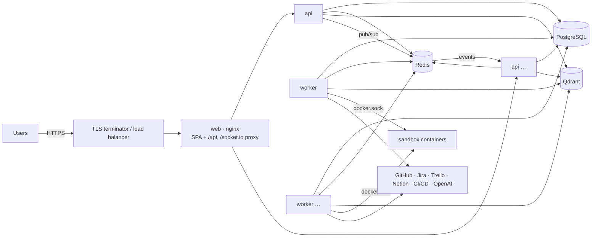

# Deployment

Vanshil's SDLC runs as three stateless services (**web**, **api** and **worker**) on top of
PostgreSQL, Redis and Qdrant. This guide covers the images, a single-host Compose deployment,
scaling out, and day-2 operations. Read [Security](SECURITY.md#hardening-checklist-production)
before exposing an installation.



## Images

| Image   | Build                                                    | Contents                                                                                            |
| ------- | -------------------------------------------------------- | --------------------------------------------------------------------------------------------------- |
| api     | `docker build -f apps/api/Dockerfile --target api .`     | Distroless Node 22, non-root (uid 65532), pruned production dependencies, health check on `/health` |
| worker  | `docker build -f apps/api/Dockerfile --target worker .`  | The api image plus the Docker CLI (no daemon) for sandbox containers; `APP_ROLE=worker`             |
| migrate | `docker build -f apps/api/Dockerfile --target migrate .` | Build stage that runs `prisma migrate deploy` (and the seed when `SEED=true`), then exits           |
| web     | `docker build -f apps/web/Dockerfile .`                  | nginx 1.27 serving the SPA. Proxies `/api` and `/socket.io` to `API_UPSTREAM` with security headers |

The web image is built same-origin, which keeps the `SameSite=Strict` session cookie
first-party. Pass `--build-arg VITE_API_URL=https://api.example.com` only if the API must live on
another origin. You would then also need `CORS_ORIGINS` and an appropriate `COOKIE_DOMAIN`.

## Single host with Docker Compose

`docker-compose.yml` runs the whole stack:

```bash
cp .env.example .env    # set production values (below)
docker compose up -d --build
docker compose ps       # migrate exits 0; api, worker and web become healthy
```

| Variable (shell or `.env`) | Default                      | Purpose                                        |
| -------------------------- | ---------------------------- | ---------------------------------------------- |
| `POSTGRES_PASSWORD`        | `forgeline`                  | Change it                                      |
| `WEB_PORT`                 | `8080`                       | Published port of the web container            |
| `SEED`                     | `false`                      | `true` only for demos (creates seed accounts)  |
| `SANDBOX_HOST_DIR`         | `/var/lib/forgeline/sandbox` | Workspace directory for code validation        |
| `DOCKER_GID`               | `999`                        | Group ID of `/var/run/docker.sock` on the host |

Put a TLS terminator (Caddy, Traefik, a cloud load balancer, …) in front of port 8080. Set:

- `COOKIE_SECURE=true` and `TRUST_PROXY=true`;
- `API_PUBLIC_URL` and `WEB_APP_URL` to the public HTTPS URL. With the bundled nginx, that is
  the same origin.

### Sandbox

The worker validates code by starting **sibling containers** through the host's Docker daemon:

1. Mount the socket: `/var/run/docker.sock:/var/run/docker.sock`.
2. The worker runs as uid **65532**, so give it the socket's group:
   `DOCKER_GID=$(stat -c %g /var/run/docker.sock)`.
3. Use the **same absolute path** on the host and in the container for the workspace directory.
   The daemon resolves bind mounts on the host. Create the directory and make it writable for
   uid 65532:
   ```bash
   sudo install -d -o 65532 -g 65532 /var/lib/forgeline/sandbox
   ```
4. Pre-pull the validation image (`SANDBOX_DEFAULT_IMAGE`, `node:22-bookworm` by default), or any
   per-repository `sandboxImage`.

Access to the Docker socket is root-equivalent on that host. Run workers on dedicated machines,
or point `DOCKER_HOST` at a remote or rootless daemon. To run without validation, set
`SANDBOX_DRIVER=disabled` and remove the two volumes. Validation results then say "not run".
`SANDBOX_DRIVER=local` is rejected in production.

## Production configuration

Required, in addition to the [configuration reference](SETUP.md#configuration-reference):

```bash
NODE_ENV=production
COOKIE_SECURE=true
TRUST_PROXY=true
API_PUBLIC_URL=https://forgeline.example.com
WEB_APP_URL=https://forgeline.example.com
JWT_SECRET=…            # from your secrets manager, at least 32 chars, unique
JWT_REFRESH_SECRET=…
ENCRYPTION_KEYS=1:…     # back this up; without it stored credentials are unrecoverable
SANDBOX_DRIVER=docker   # or disabled
METRICS_TOKEN=…
QUEUE_NAME=forgeline    # distinct per environment if Redis is shared
```

At startup the API validates these and exits with a clear message when a value is unsafe.

## Scaling

- **api**: stateless. Run N replicas behind the web tier or a load balancer. Realtime works
  across replicas because every instance relays domain events from Redis pub/sub to its own
  sockets. Use sticky sessions only if you enable Socket.IO's polling fallback through a load
  balancer; the web app connects with WebSockets.
- **worker**: stateless. Run N replicas. BullMQ distributes jobs. The step lease and the
  conditional claim prevent double execution, and the schedule and recovery loops take Redis
  locks so that only one worker runs each pass. Tune `WORKER_CONCURRENCY` (8 by default) to the
  sandbox capacity of each host.
- **PostgreSQL**: the system of record. Use managed Postgres with point-in-time recovery.
  Connection count is roughly (replicas × the Prisma pool size, `connection_limit` in
  `DATABASE_URL`).
- **Redis**: queues, pub/sub, locks and rate limits. Enable AOF persistence (Compose does). Losing
  Redis loses in-flight job hints only: the recovery sweep re-derives work from Postgres.
- **Qdrant**: the knowledge vectors, rebuildable from the knowledge documents (re-index).
  Optional at runtime; readiness reports it as non-required.

Kubernetes maps directly onto this: two Deployments (api and worker) built from the same image
with different `APP_ROLE`s, and a Job for `migrate` that runs before each rollout. Probes:

- liveness: `GET /health`;
- readiness: `GET /health/ready`.

Workers need access to a Docker daemon for the sandbox, or use `SANDBOX_DRIVER=disabled`.

## Migrations and releases

1. Build the images for the new version.
2. Run the `migrate` target to completion. Migrations are forward-only and written to be
   compatible with the previous application version, adding before removing.
3. Roll the workers, then the API, then web.

Workers finish their current job on `SIGTERM`. Shutdown hooks close the queues and connections,
and an interrupted step's lease simply expires and is retried idempotently. Running Runs
therefore survive deploys.

## Operations

| Task                     | How                                                                                                                                           |
| ------------------------ | --------------------------------------------------------------------------------------------------------------------------------------------- |
| Health                   | `GET /health` (liveness); `GET /health/ready` (Postgres, Redis, Qdrant). `503` when a required dependency is down                             |
| Metrics                  | `GET /metrics` with `Authorization: Bearer $METRICS_TOKEN`. HTTP, runs, steps, tools, LLM tokens and calls, queue jobs, WebSocket connections |
| Logs                     | JSON (pino) on stdout, with request IDs and redaction. Ship them with your log agent                                                          |
| Errors                   | Set `SENTRY_DSN` to report unexpected errors                                                                                                  |
| Backups                  | Postgres (PITR) **and** `ENCRYPTION_KEYS`. Redis and Qdrant can be rebuilt                                                                    |
| Rotate encryption keys   | See [Security → Key rotation](SECURITY.md#key-rotation)                                                                                       |
| Stuck Run                | The recovery sweep runs every 30 s. Check the Run's logs tab and `GET /api/workflow-executions/:id/logs`                                      |
| Shared Redis across envs | Set a distinct `QUEUE_NAME` per environment, or one environment's workers will take another's jobs                                            |

### Suggested alerts

- `/health/ready` failing for 2 minutes or more.
- Rate of `forgeline_workflow_runs_total{status="FAILED"}` above your baseline.
- `forgeline_tool_executions_total{status="failed", error_kind="auth"}`: an integration token
  was revoked or expired.
- Growth in `forgeline_queue_jobs_total{status="failed"}`.
- Approvals pending longer than your release SLA (the Approvals page, or the API).
