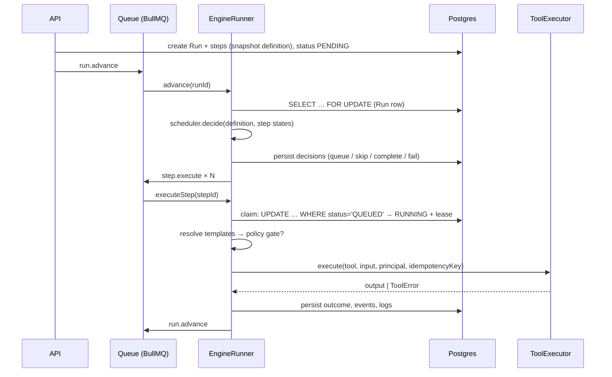
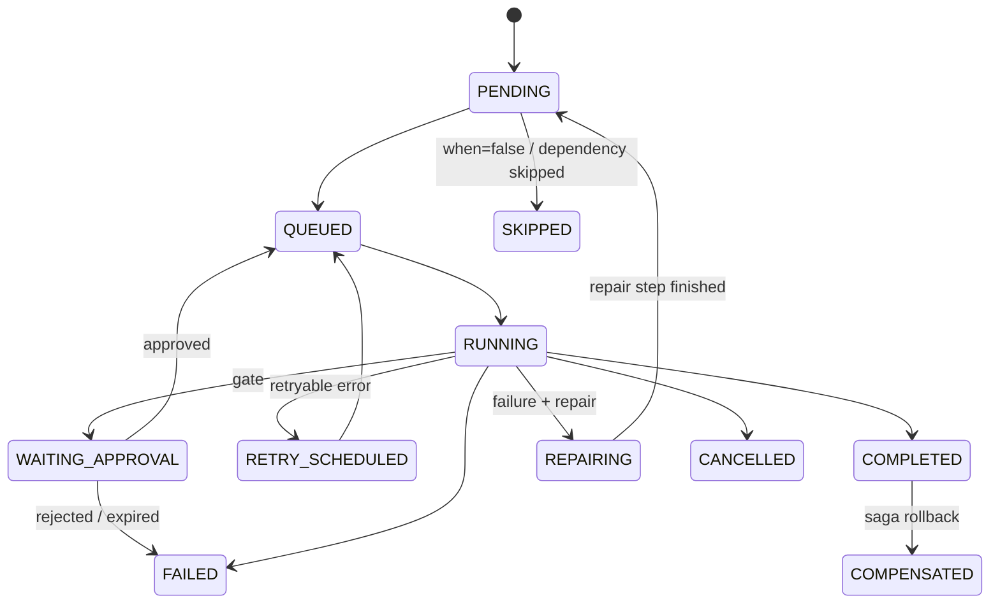

# Workflow engine

Every action Vanshil's SDLC takes runs as a **Run** of a **Flow**. The engine makes Runs durable (they
survive crashes and deploys), observable (every transition is an event and a log line), and
governed (gates, permissions, idempotency).

The code is split in two:

- **`packages/workflow-engine`** is pure: validation, the scheduler, the expression language,
  templates and backoff. It has no I/O and is unit-tested in isolation.
- **`apps/api/src/workflow-execution`** persists state in Postgres, dispatches through BullMQ,
  executes steps through the tool executor, and recovers lost work.

## The Flow language

A Flow is JSON, validated with zod (`packages/shared/src/workflow.ts`):

```jsonc
{
  "version": 1,
  "inputs": { "requirement": { "type": "string", "required": true } },
  "variables": { "baseBranch": "main" },
  "onFailure": "fail", // or "compensate" (saga)
  "concurrency": 8, // max steps running at once in this Run
  "steps": [
    {
      "key": "create_ticket",
      "name": "Create ticket",
      "tool": "ticket.create",
      "agent": "planning",
      "input": { "summary": "{{ truncate(inputs.requirement, 120) }}" },
    },
    {
      "key": "validate_code",
      "name": "Lint, typecheck & tests",
      "tool": "code.validate",
      "dependsOn": ["generate_code"],
      "input": { "codeGenerationId": "{{ steps.generate_code.output.codeGenerationId }}" },
      "successCondition": "output.passed == true",
      "repair": { "step": "fix_code", "maxIterations": 3 },
    },
    {
      "key": "fix_code",
      "name": "Fix failures",
      "tool": "code.fix",
      "input": { "failures": "{{ repair.output }}" },
    },
    {
      "key": "notify",
      "name": "Notify team",
      "tool": "notify.team",
      "dependsOn": ["deploy_production"],
      "runIf": "always",
      "input": { "message": "{{ execution.title }}: {{ steps.deploy_production.status }}" },
    },
  ],
}
```

### Step fields

| Field              | Meaning                                                                                                                                                                          |
| ------------------ | -------------------------------------------------------------------------------------------------------------------------------------------------------------------------------- |
| `key`              | `snake_case`, unique within the Flow                                                                                                                                             |
| `type`             | `tool` (default), `approval`, `condition` (its `expression` becomes `output.result`) or `delay` (`delayMs`)                                                                      |
| `tool`, `input`    | A registered tool (see `GET /api/tools`). String values may contain `{{ templates }}`                                                                                            |
| `dependsOn`        | Edges of the DAG. Steps without unmet dependencies run in parallel, up to `concurrency`                                                                                          |
| `when`             | Expression. When it is false the step is `SKIPPED`                                                                                                                               |
| `runIf`            | `all_success` (default; a skipped dependency skips this step), `none_failed` (skipped dependencies are fine, used after optional branches), `always` (cleanup and notifications) |
| `retry`            | `{ maxAttempts, backoff: fixed or exponential, initialDelayMs, maxDelayMs }`. Applies to **retryable** errors only (timeouts, rate limits, network, 5xx)                         |
| `timeoutMs`        | Per attempt; enforced with an `AbortSignal`                                                                                                                                      |
| `successCondition` | Expression over `output`. When false, success turns into a failure (and can trigger `repair`)                                                                                    |
| `repair`           | `{ step, maxIterations }`: on failure, run `step` (which sees the failed attempt as `repair.output`, `repair.error` and `repair.summary`), then run this step again              |
| `continueOnError`  | Failure does not fail the Run; dependents still run                                                                                                                              |
| `compensate`       | `{ tool, input }`, run in reverse order when the Run is compensated                                                                                                              |
| `approval`         | For `type: approval`: `title`, `description`, `action`, `risk`, `requiredPermission`, `expiresInMinutes`, `allowSelfApproval`, `context`                                         |
| `agent`, `ui`      | Presentation only: the agent persona and the builder position                                                                                                                    |

Validation (`validateWorkflowDefinition`) rejects:

- cycles, duplicate keys and unknown dependencies;
- unknown tools (including compensation tools);
- template references to steps that are not upstream, and unknown variables;
- unparsable expressions;
- invalid repair wiring: an unknown target, or a repair step that has dependencies, is itself a
  dependency, is shared by two steps, or has its own repair.

The builder, the planner, the API and Flow templates all use this one validator.

### Expressions and templates

Conditions and templates share a small, **safe** expression language. It is parsed into an AST
and evaluated without `eval` or `Function`. Prototype-related property access is refused, and
expressions are limited to 2,000 characters.

- Literals, member and index access, `! - + * / %`, `== != < <= > >=`, `in`, `&& ||`,
  `a ? b : c`.
- Functions: `len`, `contains`, `lower`, `upper`, `startsWith`, `endsWith`, `exists`, `empty`,
  `coalesce`, `string`, `number`, `json`, `join`, `slugify`, `truncate`, `pluck`.
- Scope: `inputs`, `variables`, `steps.<key>.{output,status,summary}`, `project`, `execution`,
  `env`, `event` (event triggers), `repair` (inside a repair step), and `output` and `error`
  (inside `successCondition`).

A string that is exactly one template (`"{{ steps.x.output }}"`) keeps the value's type. Mixed
strings interpolate.

## Execution model



Key properties:

- **Runs snapshot their definition.** Editing or archiving a Flow never changes a Run in flight.
- **Postgres is the source of truth.** Queue jobs are disposable hints:
  - duplicate deliveries fail the conditional claim and do nothing;
  - lost jobs are rebuilt by the recovery sweep.
- **Terminal decisions are made only by the scheduler**, while the Run is locked:
  `COMPLETED`, `FAILED`, compensation.
- **Leases.** A running step holds a 60-second lease, renewed by a heartbeat while the tool
  runs. If the worker dies, the lease expires and the step is re-queued. Its next attempt hits
  the idempotency ledger.
- **Long waits do not hold workers.**
  - Polling tools (CI runs, deployments) return a `continuation`. The engine persists the
    checkpoint and re-invokes the tool after `pollAfterMs` without consuming a retry. This
    survives restarts.
  - `delay` steps and retry backoff use delayed jobs.

### States



Run states: `PENDING`, `RUNNING`, `WAITING_APPROVAL`, `PAUSED`, `COMPLETED`, `FAILED`,
`CANCELLED`, `COMPENSATING` and `COMPENSATED`. A Run is paused or cancelled through the API.
The scheduler only dispatches while the Run is `RUNNING`, and running tools observe cancellation
through their `AbortSignal`. A failed step can be retried
(`POST /api/workflow-executions/:id/steps/:stepId/retry`), which puts the Run back to
`RUNNING`.

## Approval gates

Gates come from two places:

1. **Explicit `approval` steps**, for example "Approve implementation plan". Flow authors add
   them for any checkpoint they want.
2. **Policy gates**, injected at execution time. Just before a tool runs, the engine evaluates
   the tool's `approvalAction` against the policy (`ApprovalPolicyService`):

   | Action                                                                                              | Default             | Configurable     |
   | --------------------------------------------------------------------------------------------------- | ------------------- | ---------------- |
   | `deploy.production`, `pr.merge`, `infrastructure.destroy`                                           | **always required** | No (locked)      |
   | `deploy.staging`                                                                                    | required            | Yes, per project |
   | `deploy.development`, `ticket.create`, `code.commit`, `pr.create`, `docs.publish`, `notify.team`, … | automatic           | Yes, per project |

   `deploy.environment` resolves to `deploy.<type>` using the project's environment. An unknown
   environment is treated as **production**.

Gates live outside the Flow definition, so a Flow cannot skip them by omitting an approval step,
renaming a step or changing a `when`.

Deciding a gate:

- The approver needs the gate's `requiredPermission`. A production deploy needs
  `deploy:production` and a merge needs `code:merge`.
- Production and other locked gates are **four-eyes**: the person who started the Run cannot
  approve it.
- An approved gated step executes **with the approver's authority**, so an engineer can start a
  release that a lead authorises.
- Gates expire. The default is 7 days; a step can set `expiresInMinutes`.
- Every decision is audited, with the comment.

The approval context shown to the approver is assembled from the Run itself: the diff summary,
review findings, QA and CI results, the target environment and version, and a risk assessment.

## Idempotency

| Layer                         | Mechanism                                                                                                                                                             |
| ----------------------------- | --------------------------------------------------------------------------------------------------------------------------------------------------------------------- |
| Run start                     | Optional `idempotencyKey` per organization (commands, proposals `proposal:<id>`, schedules `schedule:<trigger>:<minute>`, webhooks by delivery ID)                    |
| Step side effects             | Ledger `ToolExecution(organizationId, idempotencyKey)` is unique. The key is derived from `<tool>:<runId>:<stepKey>:<iteration>`. A retry returns the recorded result |
| Crash between call and ledger | Adapters _find before create_ using a marker in the external system: a Jira label, a branch name, the PR head, a Notion marker, a DevOps `Idempotency-Key`            |
| Webhooks                      | `WebhookDelivery(webhookId, deliveryId)` is unique                                                                                                                    |

## Compensation (sagas)

With `onFailure: "compensate"`, or `POST /api/workflow-executions/:id/rollback`, completed steps
that declare `compensate`, or whose tool implements `compensate()`, are undone in reverse
topological order. The Run moves through `COMPENSATING` to `COMPENSATED`, and each compensation
is logged and audited. Deployments roll back through the CI/CD provider's rollback.

## Triggers

| Trigger  | Configuration                                | Notes                                                                                                                                                                                     |
| -------- | -------------------------------------------- | ----------------------------------------------------------------------------------------------------------------------------------------------------------------------------------------- |
| Manual   | `{ type: "MANUAL" }`                         | UI, API, command palette, assistant                                                                                                                                                       |
| Schedule | `{ type: "SCHEDULE", cron, timezone }`       | Evaluated every minute on workers under a Redis lock; one Run per tick (idempotent)                                                                                                       |
| Event    | `{ type: "EVENT", event, filter?, inputs? }` | Webhook events such as `jira.issue.transitioned`, `github.pull_request.opened`, `trello.card.moved` and `devops.<event>`. `filter` and `inputs` are expressions or templates over `event` |

Scheduled and event Runs act as the Flow's creator, with the creator's current permissions.

## Recovery

`RecoveryService` runs on boot and every 30 seconds, under a Redis lock so that only one worker
sweeps. It does three things:

- retries steps whose lease expired (the worker died), or fails them if no attempts are left;
- re-dispatches queued, scheduled and polling steps whose job was lost;
- re-advances Runs that are `RUNNING` with no active work;
- fails Runs that exceeded their definition `timeoutMs`.

Overdue approval gates are expired by a separate per-minute job, which fails the waiting step.

The integration suite tests this directly. It simulates a crash after a tool's side effect but
before the step was marked complete, runs the sweep, and asserts that the Run completes without
repeating the side effect.

## Observability

- Events: `workflow.*` and `workflow.step.*` (see [API](API.md#realtime)).
- Persisted, redacted step logs: `GET /api/workflow-executions/:id/logs`.
- Metrics:
  - `forgeline_workflow_runs_total{status,template,mode}`
  - `forgeline_workflow_step_duration_seconds{tool,status}`
  - `forgeline_tool_executions_total{tool,status,error_kind}`
  - `forgeline_queue_jobs_total{queue,name,status}`
- Audit: `workflow.run_started`, `workflow.run_completed` and `workflow.run_failed`, every tool
  execution, and every approval decision.
